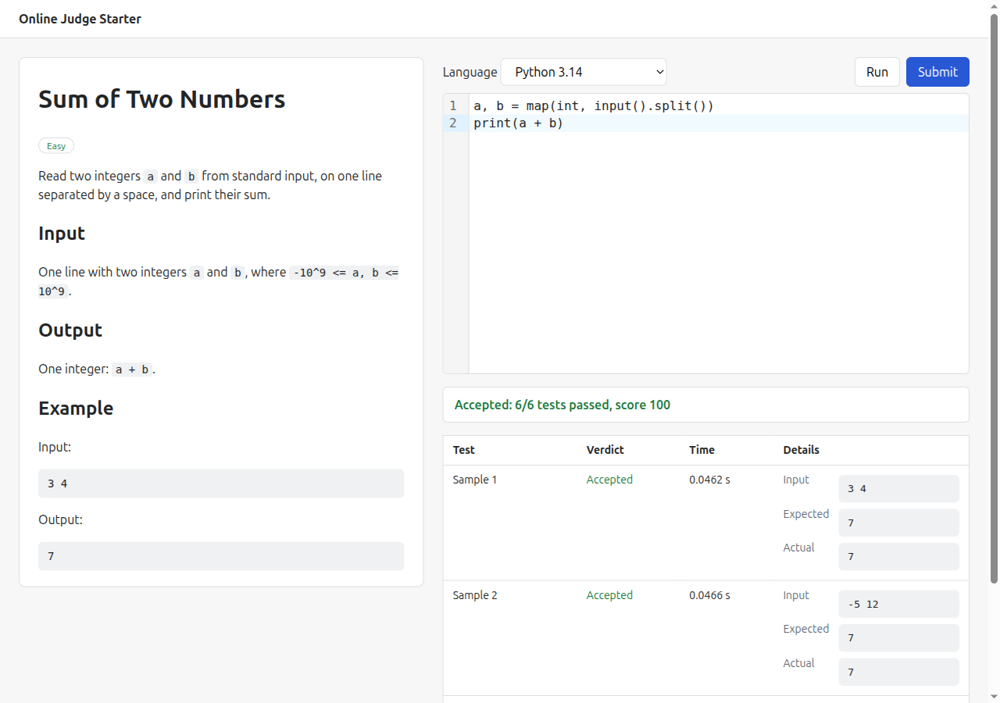

# Online Judge Starter

A small LeetCode-style practice site you can fork to start your own coding-practice or interview site. Next.js (App Router, TypeScript), a CodeMirror editor, **Run** on the sample tests, **Submit** on samples plus hidden tests, and a result table per test. Code is judged by the [OnlineCompiler.io](https://onlinecompiler.io/?utm_source=github&utm_medium=repo&utm_campaign=online-judge-starter) run-tests API through the official `onlinecompiler` npm client.



It ships with three problems (sum of two numbers, reverse the words, FizzBuzz) and starter code for Python 3.14, JavaScript (Node.js 24), C++ (G++ 15) and Java (OpenJDK 25). OnlineCompiler.io runs 46 languages; adding one here takes a line in `lib/languages.ts` and a starter per problem.

## Setup

You need Node.js 22.13 or later.

```bash
git clone https://github.com/onlinecompiler-io/online-judge-starter.git
cd online-judge-starter
npm install
cp .env.example .env.local
# put your key in .env.local as ONLINECOMPILER_API_KEY
npm run dev
```

Get a free API key at [api.onlinecompiler.io](https://api.onlinecompiler.io/compilers/api-keys/?utm_source=github&utm_medium=repo&utm_campaign=online-judge-starter). The free plan includes 100,000 runs a month, and every test of a submission counts as one run. Open http://localhost:3000.

For production use `npm run build` then `npm run start`. `npm run typecheck` runs the TypeScript compiler. The problem list is read when the site is built, so rebuild after adding a problem.

## How it works

- `problems/<slug>.json` holds a problem. `app/problems/[slug]/page.tsx` is a server component that reads it and passes the browser only the public fields (title, statement, starters, samples).
- The browser calls `POST /api/run` (samples only) or `POST /api/submit` (samples plus hidden tests) with the problem slug, the language id and the code. The route handlers in `app/api/` look the slug up, check the language and the 100 KB code limit, and call `client.runTests()`.
- The key stays on the server: `onlinecompiler` reads `ONLINECOMPILER_API_KEY` from the environment, and no browser code touches it. Never prefix it with `NEXT_PUBLIC_`.
- Errors from the client (a bad key, 429 rate limits, network failures) are turned into plain messages for the page.
- Markdown statements are rendered with `react-markdown`, which does not render raw HTML.

## Add a problem

Create `problems/<slug>.json` (lowercase letters, digits and hyphens):

```json
{
  "id": "sum-two",
  "slug": "sum-two",
  "title": "Sum of Two Numbers",
  "difficulty": "Easy",
  "statement": "Markdown text of the problem.",
  "starter": {
    "python-3.14": "a, b = map(int, input().split())\n",
    "nodejs-24": "...",
    "g++-15": "...",
    "openjdk-25": "..."
  },
  "samples": [{ "input": "3 4\n", "expected_output": "7\n" }],
  "tests": [{ "input": "1000000000 1000000000\n", "expected_output": "2000000000\n" }]
}
```

`samples` are shown to the user and run by both buttons. `tests` are the hidden tests, run only by Submit. Programs read standard input and write standard output. Outputs are compared with the API's default `trim` checker, which ignores trailing whitespace; `checker` and `scoring` can be changed in `lib/judge.ts` (see the [run-tests docs](https://onlinecompiler.io/docs/run-tests?utm_source=github&utm_medium=repo&utm_campaign=online-judge-starter)). The score is the percentage of tests passed. Java programs must declare `public class Main`. Keep the number of tests per submission modest: each is one run, and the API limits how many you can have pending at once.

## Hidden tests stay on the server

The hidden tests live in the JSON file and are only read inside the route handler. The problem page strips them before rendering (`toPublic()` in `lib/problems.ts` is an allow-list), and `lib/problems.ts` imports `server-only`, so importing it from a client component fails the build. The server also sends each hidden test with the API's `hidden: true` flag, so the API itself returns only a verdict for it: no input, expected output, actual output or error. The result table shows "Hidden test N" and its verdict.

What this does not hide: a user can see which hidden tests pass or fail (and how many), and anyone with access to your repository or server can read the JSON files. For a public repository, keep real hidden tests out of it.

## Going further

Instead of keeping hidden tests in files, store the problem on OnlineCompiler.io: the tests, checker and limits stay on the server, you submit only the candidate's code, and every judged submission comes with a signed receipt. Webhooks can post results to your server when a submission is judged in the background.

- [API docs](https://onlinecompiler.io/docs?utm_source=github&utm_medium=repo&utm_campaign=online-judge-starter), including stored problems, signed receipts and webhooks
- [How to build an online judge](https://onlinecompiler.io/how-to-build-an-online-judge?utm_source=github&utm_medium=repo&utm_campaign=online-judge-starter)

## License

MIT, copyright 2026 RunCode Inc. OnlineCompiler.io is a product of RunCode Inc.
